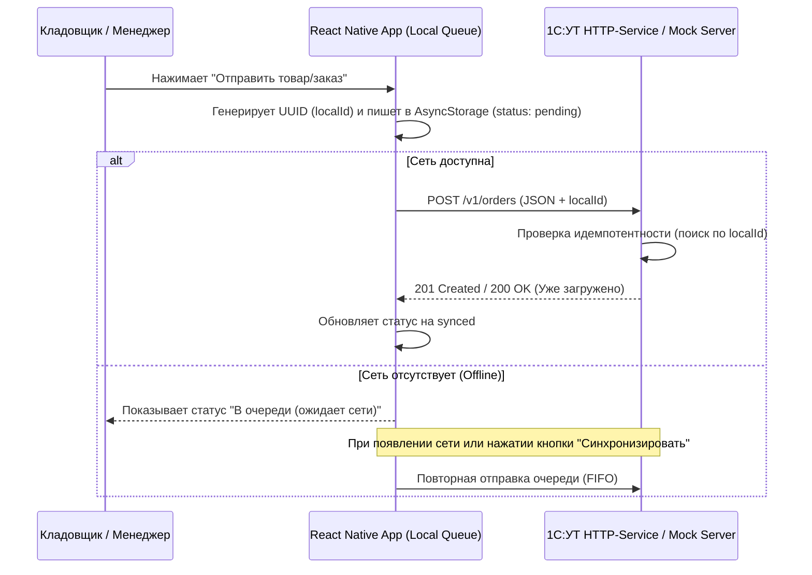

# 📱 Mobile TSD / B2B Order Terminal (Offline-First)

Мобильный клиент для сбора B2B-заказов и складского учета (эмуляция терминала сбора данных), спроектированный для интеграции с **1С:Управление торговлей 11 (1С:УТ)** по протоколу REST API.

> 🔗 **Бэкенд-часть проекта (Расширение для 1С:УТ 11):** https://github.com/Liptor/project_1c_server\

---

## 🎯 Бизнес-задача и архитектурные решения

В складской и выездной торговле главная проблема мобильных клиентов — нестабильное интернет-соединение («слепые зоны» на складе, подвальные помещения). 

В проекте реализован паттерн **Offline-First с гарантией идемпотентности**:
1. **Локальная очередь (Outbox Pattern):** При оформлении заказа данные мгновенно сохраняются в локальное хранилище устройства со статусом `pending` и уникальным ключом `localId` (`UUID v4`). Пользователь не ждет ответа сети.
2. **Автоматическая и ручная синхронизация:** Фоновый воркер отслеживает состояние сети (`NetInfo`) и отправляет накопленные заказы при восстановлении связи. Также доступна принудительная отправка по кнопке.
3. **Защита от дублей (Idempotency):** При обрыве связи в момент подтверждения заказа клиент может отправить запрос повторно. Серверная часть (как `mock-server`, так и расширение `1С:УТ`) проверяет `localId` и гарантирует, что в базе не создадутся дубли документов.

---

## 🏗 Архитектура взаимодействия



---

## 🛠 Технологический стек

* **Mobile:** React Native, TypeScript
* **Состояние и хранение:** AsyncStorage (персистентная очередь), NetInfo (мониторинг сети)
* **Локальный стенд (Mock API):** Node.js, Express (полная эмуляция контрактов REST API 1С:УТ для автономной разработки и тестирования)
* **Target Backend:** 1С:Предприятие 8.3 (УТ 11), HTTP-сервисы, JSON

---

## 🔌 API Контракты (Совместимы с расширением 1С:УТ)

| Метод | Эндпоинт | Описание |
| :--- | :--- | :--- |
| `GET` | `/v1/catalog` | Получение актуального каталога номенклатуры и цен из 1С |
| `POST` | `/v1/orders` | Передача сформированного заказа в 1С с проверкой `localId` на дубли |

### Пример Payload (`POST /v1/orders`)
```json
{
    {
      "productId": "000000123",
      "name": "Кабель ВВГнг 3х2.5",
      "article": "KGN39VL316",
    }
}
```

---

## 🚀 Быстрый запуск локально

Для локального тестирования без развернутого веб-сервера 1С в репозиторий включен `mock-server.js`, полностью повторяющий логику ответов и проверку идемпотентности 1С-расширения.

### 1. Запуск Mock-сервера
```bash
cd mock-server
npm install
node mock-server.js
# Сервер запустится на http://localhost:3000
```

### 2. Запуск мобильного приложения
```bash
cd mobile-app
npm install
npx react-native run-ios # или run-android
```

---

## 📸 Демонстрация работы (Offline -> Online)
