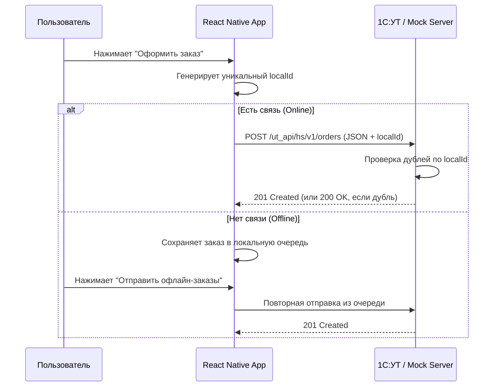
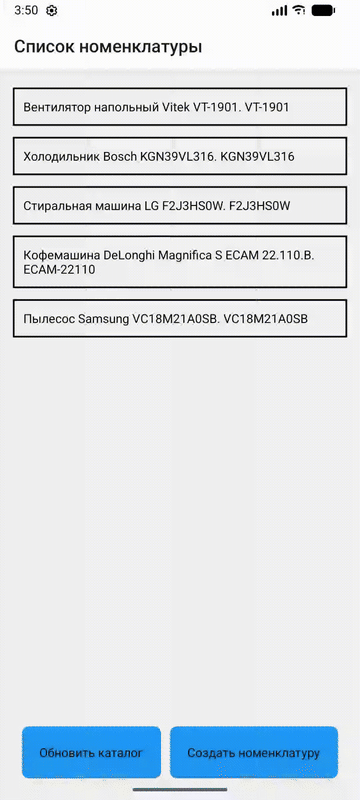

# 📱 Mobile TSD / B2B Order Terminal

Мобильный клиент для сбора B2B-заказов и складского учета (эмуляция терминала сбора данных), спроектированный для интеграции с **1С:Управление торговлей 11 (1С:УТ)** по протоколу REST API.

> 🔗 **Бэкенд-часть проекта (Расширение для 1С:УТ 11):** [github.com/Liptor/project_1c_server](https://github.com/Liptor/project_1c_server)

---

## 🎯 Бизнес-задача и архитектурные решения

В складской и выездной торговле главная проблема мобильных клиентов — нестабильное интернет-соединение («слепые зоны» на складе, подвальные помещения). 

В проекте реализована **работа с офлайн-очередью и защита от дублей**:
1. **Локальная очередь заказов:** При отсутствии сети (или в режиме симуляции Offline) заказ не теряется, а сохраняется в локальную очередь на устройстве с уникальным идентификатором `localId`.
2. **Ручная синхронизация по кнопке:** Как только связь восстановлена, пользователь отправляет накопленную очередь одним нажатием.
3. **Защита от дублей (Idempotency):** При повторной отправке одного и того же запроса серверная часть (`mock-server` и расширение `1С:УТ`) проверяет `localId` и гарантирует, что дубли документов не создадутся.

---

## 🏗 Архитектура взаимодействия



---

## 🛠 Технологический стек

* **Mobile:** React Native, TypeScript
* **Локальный стенд (Mock API):** Node.js, Express (эмуляция контрактов REST API 1С:УТ для автономной разработки и тестирования)
* **Target Backend:** 1С:Предприятие 8.3 (УТ 11), HTTP-сервисы, JSON

---

## 🔌 API Контракты (Совместимы с расширением 1С:УТ)

| Метод | Эндпоинт | Описание |
| :--- | :--- | :--- |
| `GET` | `/ut_api/hs/v1/catalog` | Получение каталога номенклатуры из 1С |
| `POST` | `/ut_api/hs/v1/orders` | Передача заказа с проверкой `localId` на дубли |

### Пример Payload (`POST /ut_api/hs/v1/orders`)
```json
{
  "localId": "1731675000000-a1b2c",
  "item": {
    "name": "Кабель ВВГнг 3х2.5",
    "article": "KGN39VL316"
  }
}
```

---

## 🚀 Быстрый запуск локально

Для локального тестирования без развернутого веб-сервера 1С в репозиторий включен `mock-server.js`, повторяющий логику ответов и проверку идемпотентности 1С-расширения.

### 1. Запуск Mock-сервера
```bash
cd mock
node mock-server.js
# Сервер запустится на http://localhost:3000
```

### 2. Запуск мобильного приложения
```bash
cd project_1c
npm start
npx run android # или run ios
```

---

## 📸 Демонстрация работы (Offline -> Online)


